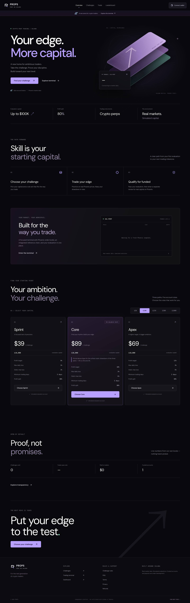
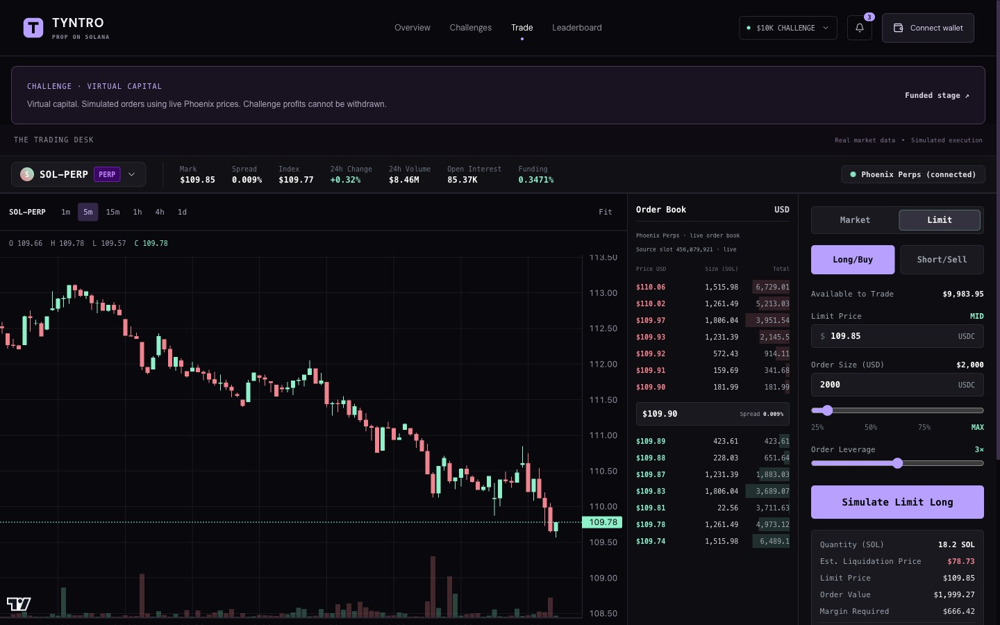
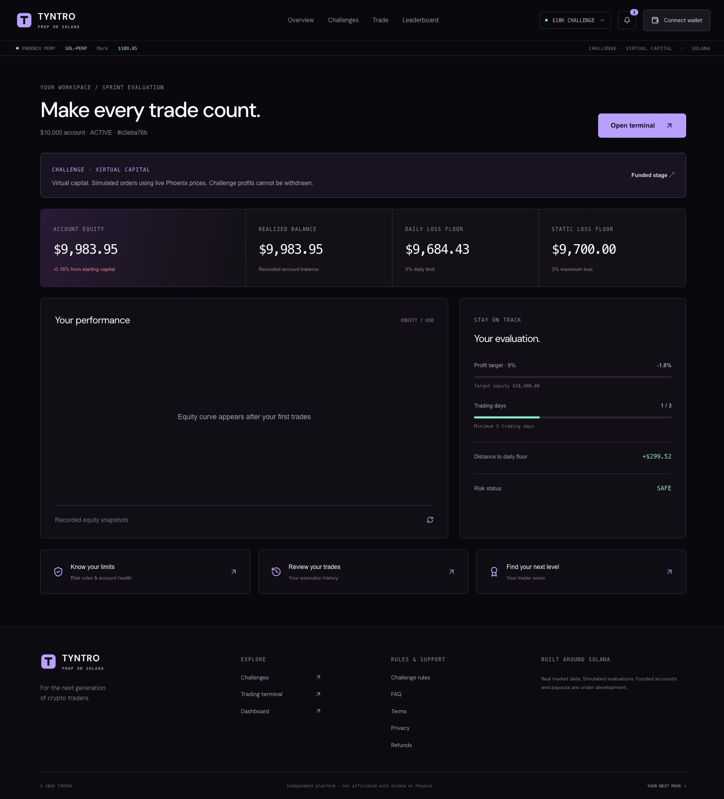
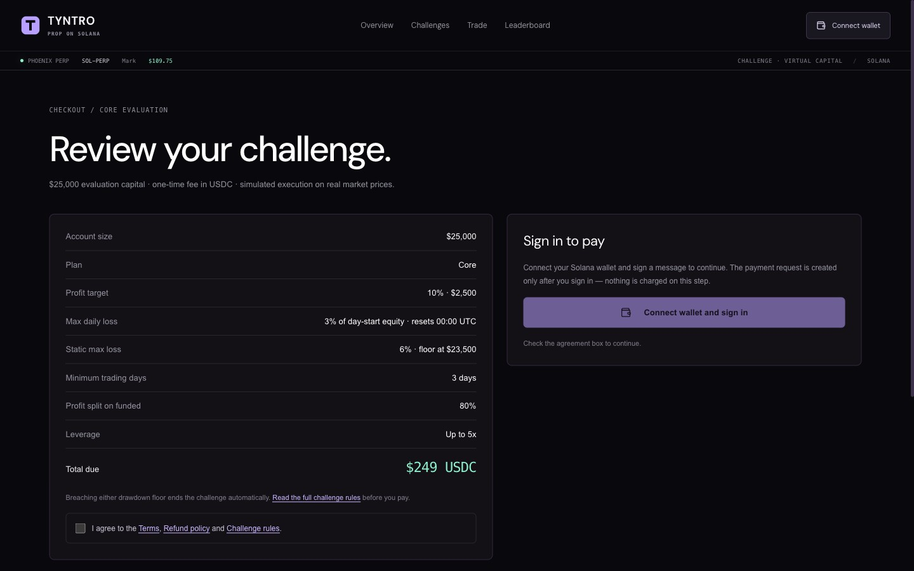
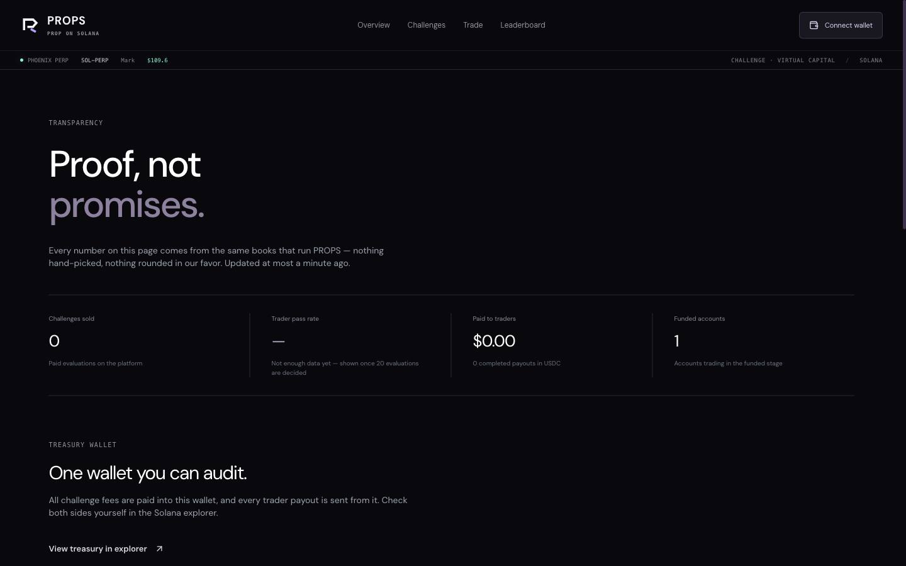
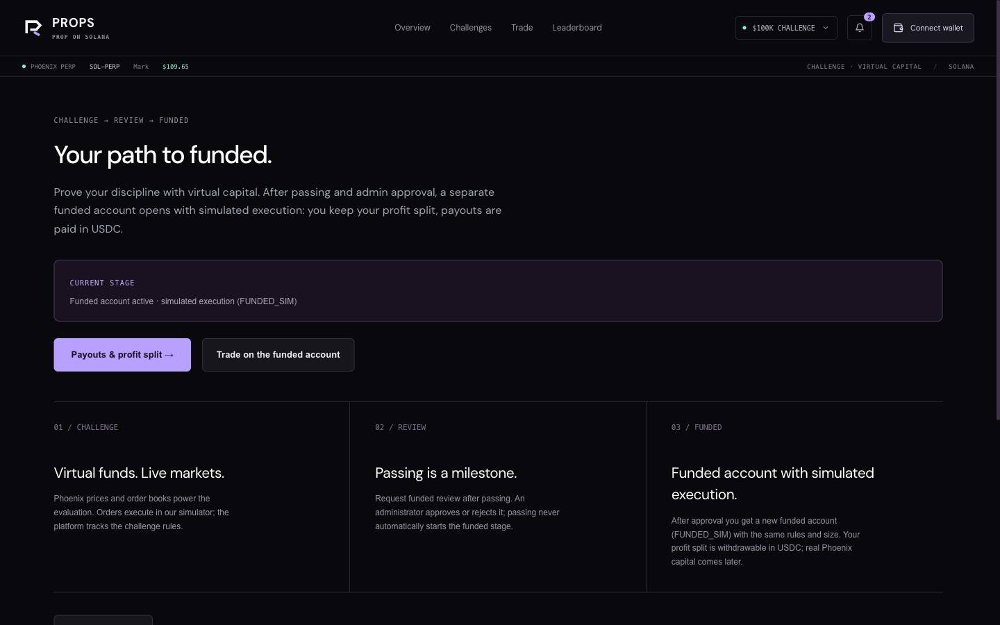
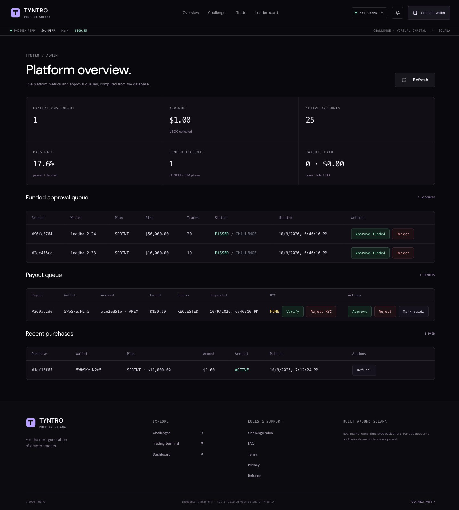
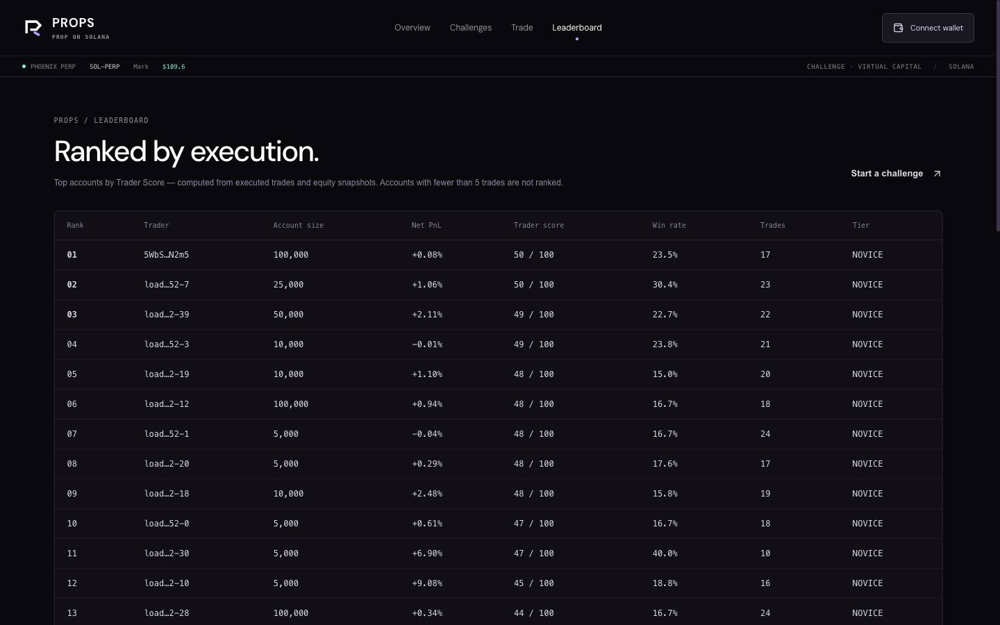
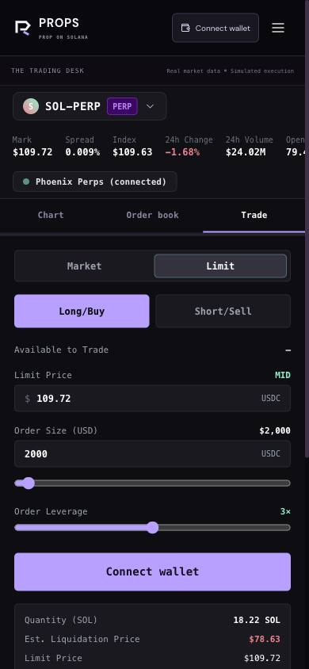

# Tyntro

**A transparent prop firm for crypto perps, built on Solana.**

**English** · [Русский](README.ru.md)


Tyntro lets anyone prove they can trade without risking their own capital. A trader
pays for an evaluation challenge in USDC with Solana Pay, trades perpetual futures on a
virtual account priced by live [Phoenix](https://phoenix.trade) markets, and a risk
engine checks every rule once per second. Pass the challenge and the account becomes
funded: the trader keeps 80% of the profit.



## The problem

Prop trading firms are a big market, but traders have to trust them blindly:

- Rules are vague and can change after you pay.
- Nobody can check whether the firm has money to pay out.
- Card payments exclude much of the world and take days to settle.
- Pass/fail decisions are made behind closed doors.

## How Tyntro solves it

| Problem | Tyntro |
|---------|--------|
| Rules change after purchase | Each account stores a **hash of its plan rules** (`rulesHash`) at purchase. The risk engine enforces exactly those rules. |
| Hidden finances | The **transparency page** reads the treasury's USDC balance directly from Solana and lists funded accounts. |
| Slow, card-only payments | **USDC via Solana Pay**. Each purchase has a unique reference key; the worker finds the transfer on-chain and opens the account automatically. |
| Opaque decisions | The **risk engine is deterministic**, logged and covered by tests. Every balance change is a ledger entry, and every admin action goes to an audit log. Rules page shows worked examples. |
| Fake "real market" | Fills use **live Phoenix order books**, the on-chain perps DEX on Solana. The leaderboard is built only from real trades. |

## Why Solana

- **Solana Pay + USDC**: checkout in seconds for a few cents, no card processor,
  no chargebacks, open to traders in any allowed country.
- **Sign-in with Solana (SIWS)**: the wallet is the account. No passwords, no emails.
- **Phoenix**: a fully on-chain order book gives honest, verifiable prices for the simulator.
- **Public treasury**: anyone can verify the payout reserve on-chain at any time.

| On-chain | Off-chain (server) |
|----------|--------------------|
| USDC payments with a per-purchase reference key | Simulated execution and positions |
| Treasury balance shown on `/transparency` | Risk engine (1 s tick), ledger, audit log |
| Payout and refund transfers (signature stored with the record) | KYC, admin decisions |
| Wallet signatures for sign-in | Leaderboard, Trader Score |
| Phoenix market data (read) | |

## What works today

- Full trader journey: sign in → pay USDC → trade → PASSED → funded approval → profit → payout request.
- **221 automated tests** (`node:test`) on a real PostgreSQL, including the risk engine,
  execution, payments, payouts and auth.
- **End-to-end script** (`scripts/e2e.ts`) runs the whole journey against a live app.
- **Real devnet payment** with real wallets and USDC transactions (`scripts/devnet-real.ts`).
- **Load test**: bot accounts trading on recorded Phoenix prices, then a ledger audit
  (`scripts/check-ledger.ts`) that must report zero violations.
- Production stack: Docker, Caddy with HTTPS, daily backups, health checks, CI.

## Screenshots

| Trading terminal | Trader dashboard |
|---|---|
|  |  |
| **Checkout (Solana Pay)** | **Transparency** |
|  |  |
| **Funded account** | **Admin panel** |
|  |  |
| **Leaderboard** | **Mobile terminal** |
|  |  |

## Features

- **Challenges.** Three plans (Sprint, Core, Apex) for $5K–$100K virtual accounts.
  Paid in USDC on Solana; the worker confirms the transfer on-chain and opens the account.
- **Trading terminal.** Live Phoenix data over WebSocket: mark and index price, 24h
  stats, open interest, funding, order book, chart. Market and limit orders with leverage.
- **Risk engine.** A worker re-prices open positions every second and enforces the
  daily loss floor, the max drawdown, maintenance-margin liquidation, the profit target
  and the minimum number of trading days.
- **Funded stage and payouts.** Admin approval of funded accounts, 80% profit split,
  payout requests with a KYC step.
- **Public pages.** Leaderboard built from real trades, Trader Score, a transparency
  page with the on-chain treasury, rules with worked drawdown examples.
- **Admin panel.** Revenue and account metrics, funded and payout queues, refunds.
- **Sign-in with Solana** (SIWS): the wallet signs a message; no passwords.
- **Money is exact.** All amounts and prices are `Prisma.Decimal`, never `number`.

| Plan   | Profit target | Daily loss limit | Max drawdown | Min trading days | Profit split |
|--------|---------------|------------------|--------------|------------------|--------------|
| Sprint | 9%            | 3%               | 3%           | 3                | 80%          |
| Core   | 10%           | 3%               | 6%           | 3                | 80%          |
| Apex   | 12%           | 3%               | 5%           | 3                | 80%          |

Prices per account size live in `src/lib/pricingConfig.ts`; `npm run seed` syncs them to the database.

> **Testing period:** Core $10K costs **$1** so anyone can try a real USDC purchase end to end. The regular price is $99.

## Tech stack

Next.js 16 (App Router) · React 19 · TypeScript · Tailwind CSS · Prisma 6.19 ·
PostgreSQL 17 · `@solana/web3.js` and wallet-adapter · lightweight-charts ·
`node:test` + `tsx` · Docker.

## How it works

```
browser ──► web (Next.js, :3000) ──► PostgreSQL ◄── worker (tsx)
               │  pages + /api/*                       │ risk tick every 1 s
               │  orders, auth, checkout               │ day roll every 30 s
               ▼                                       │ USDC payment checks
         Phoenix market data (Solana RPC) ◄────────────┘
```

| Service   | Command                                                            |
|-----------|--------------------------------------------------------------------|
| `db`      | PostgreSQL 17 (host port `54339`)                                  |
| `migrate` | `prisma migrate deploy && node --import tsx prisma/seed.ts` (runs once) |
| `web`     | `node server.js` (Next.js standalone, port 3000)                   |
| `worker`  | `./node_modules/.bin/tsx src/worker/index.ts`                      |

All three app services share one image (Node 22 Alpine, multi-stage, `next build` standalone).

## Getting started


### Requirements

- Node.js 22.12 or newer, npm
- Docker with Compose v2
- A Solana wallet (Phantom or similar) to sign in in the browser

### Option A: everything in Docker

Starts `db`, runs migrations and seed once (`migrate`), then `web` on
http://localhost:3000 and `worker`:

```sh
git clone https://github.com/ytolep/tyntro.git && cd tyntro
cp .env.example .env               # optionally set ADMIN_WALLET and others
docker compose up -d --build
curl http://localhost:3000/api/health
```

If host port 54339 is taken, run the database on another one:
`DB_PORT=54340 docker compose up -d --build` (the host port is only used by tests and `psql`).

### Option B: local development

```sh
npm ci
cp .env.example .env               # DATABASE_URL already points to localhost:54339
docker compose up -d db            # PostgreSQL only
npx prisma migrate deploy
npm run seed                       # challenge matrix + optional ADMIN
npm run dev                        # web on http://localhost:3000
npm run worker                     # risk engine, in a second terminal
```

The worker is required for trading: without it orders are not filled against the
risk rules and payments are not confirmed.

### Make yourself an admin

Roles live in `User.role` (`USER` or `ADMIN`). Put your wallet address into
`ADMIN_WALLET` and run the seed again (it is an idempotent upsert):

```sh
ADMIN_WALLET=<your-address> docker compose up migrate    # or locally:
ADMIN_WALLET=<your-address> npm run seed
```

After you sign in with that wallet, `/admin` and `/api/admin/*` are available.

### Test payments on devnet

Build the web app with `NEXT_PUBLIC_SOLANA_CLUSTER=devnet`, set `TREASURY_WALLET`,
`USDC_MINT` (devnet USDC) and `PAYMENTS_RPC_URL=https://api.devnet.solana.com`, and
switch the wallet to Devnet. Market data still comes from Phoenix on mainnet.
See [docs/DEMO.md](docs/DEMO.md) for a full demo setup with bots.

## Commands

| Command             | What it does                                                   |
|---------------------|----------------------------------------------------------------|
| `npm run dev`       | Next.js dev server                                             |
| `npm run worker`    | Worker: risk tick (1 s), day roll (30 s), payment checks       |
| `npm run seed`      | Upsert challenge plans and prices, optional ADMIN user         |
| `npm test`          | All `*.test.ts` with `node:test`, database from `.env.test`    |
| `npm run typecheck` | `tsc --noEmit`                                                 |
| `npm run build`     | Production build (standalone output)                           |
| `npm start`         | Serve the production build                                     |

Tests use the `props_test` database on port 54339 (created by
`docker/initdb/01-props-test.sql`) and recreate the schema themselves with
`prisma db push --force-reset`.

Helper scripts in `scripts/` (run with `npx tsx scripts/<name>.ts`):

| Script            | Purpose                                                     |
|-------------------|-------------------------------------------------------------|
| `e2e.ts`          | End-to-end scenario against a running app                   |
| `bot-load.ts`     | Load test: N bot accounts trading on recorded Phoenix prices |
| `check-ledger.ts` | Ledger consistency check, expects zero violations           |
| `record-prices.ts`| Record Phoenix prices for replay                            |
| `devnet-real.ts`  | Real USDC payment on devnet, end to end                     |
| `demo-shape.ts`   | Shape demo data (passed and funded accounts)                |
| `manual-qa.ts`    | Automated checks against `BASE_URL` plus the manual QA checklist |
| `natural-pass.ts` | Passes a Sprint challenge with real trades only, no manual adjustments |

## Configuration

Copy `.env.example` to `.env`. For production use `.env.production.example`, which documents every variable.

| Variable                     | Required | Default | Purpose |
|------------------------------|----------|---------|---------|
| `DATABASE_URL`               | yes      | —       | PostgreSQL connection for web, worker, seed and tests |
| `TREASURY_WALLET`            | for payments | —   | Wallet that receives USDC; without it checkout and payment checks are off |
| `SOLANA_RPC_URL`             | no       | `https://api.mainnet-beta.solana.com` | Phoenix market data and payment checks |
| `PAYMENTS_RPC_URL`           | no       | `SOLANA_RPC_URL` | RPC for payment confirmation only (devnet tests) |
| `USDC_MINT`                  | no       | mainnet USDC | Mint accepted for payments |
| `NEXT_PUBLIC_SOLANA_RPC_URL` | no       | —       | Wallet RPC in the browser (build time) |
| `NEXT_PUBLIC_SOLANA_CLUSTER` | no       | `mainnet-beta` | Wallet cluster when no RPC is set (build time) |
| `NEXT_PUBLIC_BRAND_NAME`, `NEXT_PUBLIC_SUPPORT_EMAIL` | no | — | Branding (build time) |
| `TAKER_FEE_RATE`             | no       | `0.0005` | Simulated taker fee |
| `ADMIN_WALLET`               | no       | —       | Seed creates an ADMIN user for this wallet |
| `APP_DOMAINS`, `APP_DOMAIN`  | in production | — | Allowed hosts for SIWS (CSV) and the fallback domain |
| `TRUSTED_IP_HEADER`, `TRUSTED_PROXY_COUNT` | no | —, `1` | How to read the client IP behind a proxy |
| `BLOCKED_COUNTRIES`          | no       | `US,CU,IR,KP,SY,RU,BY` | Geo-block, ISO 3166 alpha-2 codes |
| `DB_PORT`                    | no       | `54339` | Host port of PostgreSQL in Docker Compose |

## Health check

`GET /api/health` checks the database and the worker. The worker writes a heartbeat
every 5 seconds; if the last risk tick is older than 30 s (or the last payment check
older than 90 s while payments are on), the endpoint returns HTTP 503 with
`"status":"degraded"`.

```json
{"status":"ok","db":"up","version":"2.0.0","worker":{"ok":true,"payments":"disabled","lastTickAgeMs":3232,"lastPaymentsCheckAgeMs":null}}
```

`GET /api/health?scope=web` checks only the database; it is meant for the web container's healthcheck.

## Project structure

```
src/app/            pages (terminal, dashboard, checkout, funded, admin, ...) and /api routes
src/lib/core/       money, positions, risk rules, Trader Score
src/lib/execution/  simulated order execution, margin, leverage policy
src/lib/marketData/ Phoenix market data: WebSocket stream, candles, order book
src/lib/payments/   Solana Pay checkout and on-chain verification
src/worker/         risk tick, day roll, payment checks, heartbeat
prisma/             schema, migrations, seed
scripts/            e2e, load, ledger and demo scripts
deploy/             production stack: Caddy (HTTPS), backups, restore
docs/               deploy guide, demo, QA, reviews (in Russian)
```

## Deployment

A single Linux server with Docker: `deploy/docker-compose.prod.yml` adds Caddy with
Let's Encrypt and daily `pg_dump` backups. Step-by-step guide, devnet → mainnet and
security checklists: [docs/DEPLOY.md](docs/DEPLOY.md). Try the production stack
locally with `deploy/local-check.sh`.

CI (`.github/workflows/ci.yml`) runs typecheck, tests against PostgreSQL 17 and the build on every push.

## Business model

Traders pay a one-time challenge fee ($25–$899 depending on plan and size; Core $10K is $1 during testing). Funded
traders keep 80% of their profit; the firm keeps 20%. Payouts come from the public
treasury, so the reserve is always visible.

## Roadmap

- Mainnet launch (the devnet → mainnet checklist is in [docs/DEPLOY.md](docs/DEPLOY.md)).
- Automated USDC payouts signed by the treasury instead of manual admin transfers.
- Publish rule hashes and daily account results on-chain, so anyone can audit pass/fail decisions.
- More Phoenix markets and more plans.

## Re-recording the demo GIF

The terminal GIF is made with [VHS](https://github.com/charmbracelet/vhs):

```sh
brew install vhs
vhs docs/demo/commands.tape        # writes docs/demo/commands.gif
```
